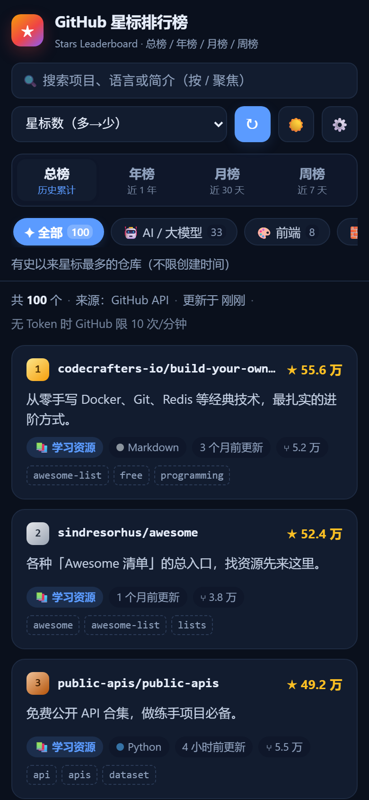
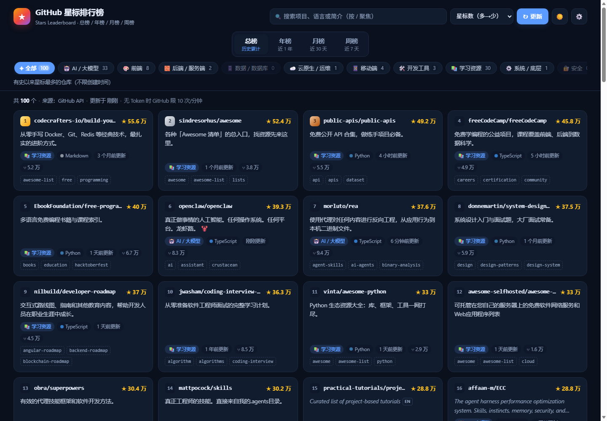

# GitHub 星标排行榜 · GitHub Star Ranking

在浏览器里浏览 GitHub 上星标最多的项目：**总榜 / 年榜 / 月榜 / 周榜**，按类别筛选，支持搜索、排序，一键拉取最新数据。

单个静态页面，零依赖、零构建、没有后端，断网也能打开（内置离线快照）。

`MIT License` · `零依赖` · `原生 JS` · `无构建` · `单文件 84 KB` · `响应式`


## 特性

- **四个榜单维度**：总榜（历史累计）、年榜、月榜、周榜，一键切换
- **按类别筛选**：AI / 大模型、前端、后端 / 服务端、数据 / 数据库、云原生 / 运维、移动端、开发工具、学习资源、系统 / 底层、安全、其他，带数量角标
- **搜索与排序**：按仓库名、简介、语言、topic 实时过滤；支持按星标数、最近更新、名称排序
- **项目卡片**：仓库名、星标数、分叉数、主语言、分类、topics、中文简介，直接跳转仓库
- **一键更新**：随时拉取最新榜单，显示数据来源与更新时间
- **深色模式**：跟随系统，也可手动切换，选择会被记住
- **响应式**：宽屏四列、平板三列、手机单列
- **离线可用**：网络不可用时自动回退到内置快照（星标以 `≈` 标出），不会白屏

<p align="center">
  
  
</p>

## 榜单口径

星标数取 GitHub 上的实时累计值。GitHub 接口**不提供**「某段时间新增了多少星」，所以时间维度的榜单按**创建时间**筛选：

| 榜单 | 查询条件 | 含义 |
| --- | --- | --- |
| 总榜 | `stars:>=1000`，按星标降序 | 历史累计星标最高的仓库 |
| 年榜 | `created:=近 365 天` + `stars:>=300` | 近一年新建、且星标最高的仓库 |
| 月榜 | `created:=近 30 天` + `stars:>=10` | 近 30 天新建、且星标最高的仓库 |
| 周榜 | `created:=近 7 天` + `stars:>=3` | 近 7 天新建、且星标最高的仓库 |

也就是说，月榜 / 周榜是「**新建项目榜**」，不是「涨星榜」。页面顶部对当前榜单也有对应说明。

## 快速开始

不需要安装任何东西，直接打开页面即可：

```bash
git clone https://github.com/<用户名>/<仓库名>.git
cd <仓库名>
# 双击 index.html，或用任意静态服务器：
# python -m http.server 8000
```

只想要一个文件？`dist/github-star-ranking.html` 是自包含单文件版，下载后双击就能跑。

## 部署到 GitHub Pages

这是一个纯静态站点，GitHub Pages 可以直接托管，无需构建：

1. 把代码推到仓库的 `main` 分支。
2. 仓库 **Settings → Pages**，Source 选 **Deploy from a branch**，Branch 选 `main` + `/ (root)`，保存。
3. 约 1–2 分钟后，`https://<用户名>.github.io/<仓库名>/` 即可访问。

> `.nojekyll` 已包含在仓库中，用于跳过 Jekyll 处理；所有资源使用相对路径，部署在子路径下也能正常工作。

常见 404 原因：`index.html` 不在仓库根目录、Pages 分支 / 目录选错、仓库为私有（免费账号的 Pages 仅支持公开仓库）、Actions 里的 `pages build and deployment` 构建失败。

## 数据来源与限制

请求按顺序自动降级，任一失败即换下一个：

1. `https://api.github.com`（官方接口，填了 Token 才会附带）
2. `https://gh-proxy.com/…` 镜像
3. `https://api.kkgithub.com` 镜像
4. `corsproxy.io` / `allorigins.win` 中转

GitHub 搜索接口未登录时约 **10 次/分钟**，页面每次刷新只发一个请求，正常使用不会触发。若需要更高额度，可以到 [GitHub Settings → Tokens](https://github.com/settings/tokens) 生成一个只读 Token，在页面右上角 ⚙️ 中填入。

Token 只保存在浏览器 localStorage，只会发送给 `api.github.com`，不会写入代码或上传。

## 中文简介

卡片简介按以下优先级生成：

1. 内置人工词典（`core.js` 中的 `ZH_DICT`，覆盖百余个常见项目）
2. 机器翻译（MyMemory 免费接口，翻译结果会缓存到本地）
3. 英文原文（卡片标记 `EN`）

仓库简介本身就是中文的会直接展示，不做翻译。

## 自定义

| 想调整 | 位置 |
| --- | --- |
| 分类规则（关键词 → 分类，顺序即优先级） | `core.js` → `RULES` |
| 分类名称与图标 | `core.js` → `CATEGORIES` |
| 榜单时间跨度、星标门槛、翻页页数 | `core.js` → `BOARDS` |
| 中文简介词典 | `core.js` → `ZH_DICT` |
| 离线快照数据 | `snapshot.js` |
| 主题色、间距 | `styles.css` 顶部 CSS 变量 |

离线模式：在地址后加 `?snapshot=1`，例如 `index.html?snapshot=1`，页面不发任何网络请求。

## 项目结构

```
github-star-ranking/
├── index.html      页面结构
├── styles.css      样式（主题变量 + 响应式）
├── core.js         纯逻辑：榜单定义、分类器、查询构造、筛选排序、格式化
├── snapshot.js     内置离线快照
├── app.js          渲染 + 网络请求 + 缓存 + 设置
├── tests/
│   └── selftest.js 纯逻辑自测
├── tools/          无头浏览器验证脚本、单文件打包脚本
├── preview/        截图
├── dist/
│   └── github-star-ranking.html   单文件版（构建产物）
├── LICENSE         MIT
└── .nojekyll
```

## 开发与测试

```bash
# 纯逻辑自测（分类器 / 查询构造 / 排序筛选 / 格式化 / 链接 / 快照完整性，67 项）
node tests/selftest.js

# 界面冒烟测试（需要 Edge 或 Chrome 的无头模式，离线快照即可运行，27 项）
msedge --headless=new --remote-debugging-port=9334 --user-data-dir=%TEMP%\eg about:blank
node tools/ui-smoke.mjs --url=file:///<绝对路径>/index.html?snapshot=1 --port=9334

# 重新生成单文件版
node tools/build-standalone.mjs
```

## 已知限制

- 纯前端实现，没有服务端缓存；数据直接来自 GitHub 接口，受接口限流影响。
- 月榜 / 周榜为「新建项目榜」，GitHub 不提供涨星数据。
- 分类为关键词启发式判断，个别项目可能归类不准，可在 `RULES` 中调整。
- 机器翻译受第三方免费接口额度限制，用尽时回退为英文原文。

## 许可证

[MIT](LICENSE)
